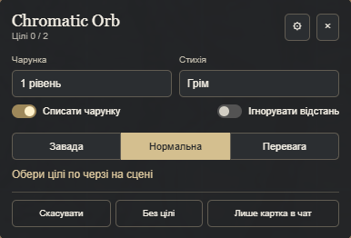
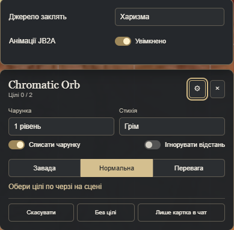

# Створення макросів із ChatGPT

Навичка для **Foundry VTT 14 / dnd5e 6.x**: компактний український інтерфейс, вибір цілей на сцені, кидки Dice So Nice та інтеграція з [Fantik’s Automations](https://github.com/funteaqueue/funtomations).

## Скопіюйте в чат

> Прочитай навичку https://github.com/funteaqueue/funtomations/blob/main/skills/foundry-macros/SKILL.md і потрібні посилання всередині, включно з прикладом Chromatic Orb та довідкою API модуля. Допоможи створити макрос для [назва та опис механіки] під Foundry 14 / dnd5e 6.x. Використай компактний український інтерфейс. Поверни лише готовий JavaScript без JSON. Якщо якесь джерело недоступне, повідом про це.

Додайте свої версії Foundry/dnd5e, установлені модулі й бажану механіку. Посилання дає AI інструкції для цього запиту; воно не встановлює модуль або макрос у ваш світ.

## Файли

- [SKILL.md — основні інструкції](SKILL.md)
- [Chromatic Orb v3.1 — приклад](assets/chromatic-orb.js)
- [API Fantik’s Automations](references/fantik-automations.md)
- [Які приклади використовувати](references/examples.md)
- [ZIP усієї навички](https://github.com/funteaqueue/funtomations/raw/refs/heads/main/skills/foundry-macros-community.zip)

Якщо чат не може відкрити GitHub, прикріпіть файли з ZIP. Довідка описує модуль 0.8.4 / spellCards API 5; перевіряйте можливості фактично встановленої версії. Після генерації спочатку перевірте макрос на тестовому токені.

## Приклад інтерфейсу

Основна панель й другорядні налаштування за шестернею:

